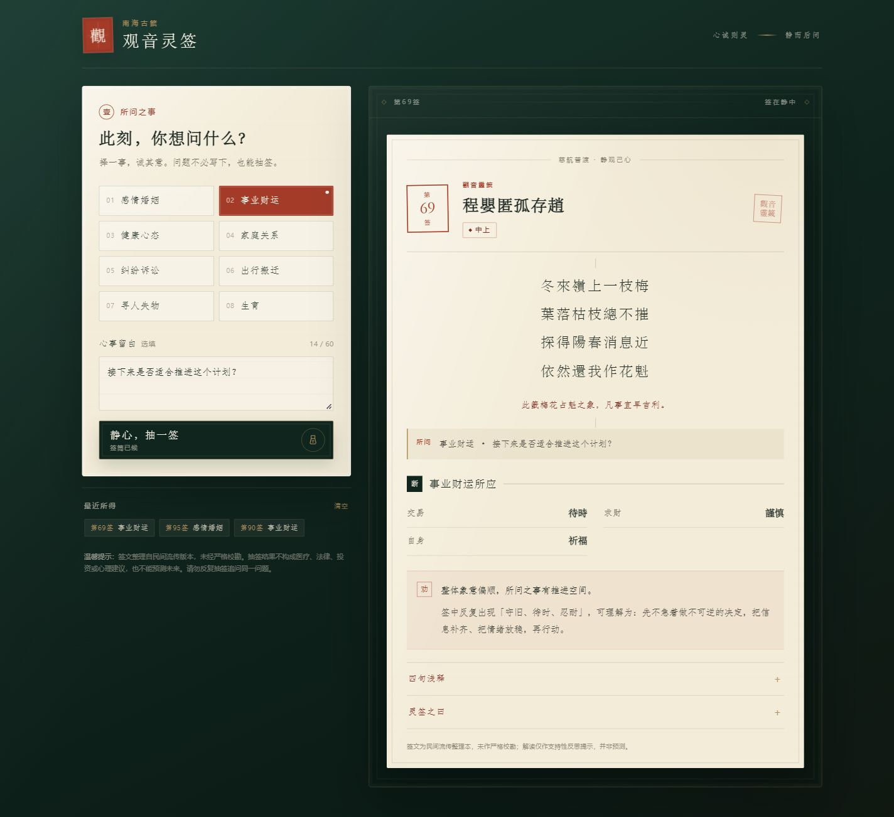
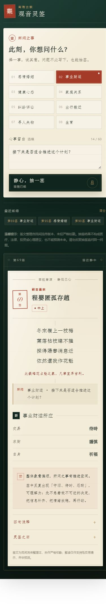

[简体中文](README.md) | English

# Guanyin Lingqian · A Quiet Question

An offline-ready, question-driven divination page based on the 100 lots of Guanyin Lingqian (观音灵签).

Built with vanilla HTML, CSS, and JavaScript. Zero dependencies, one file, and ready for GitHub Pages.

> This project is a cultural display and self-reflection tool, not a fortune-telling or prediction service. Draw results do not constitute medical, legal, financial, or psychological advice. Please read the [Disclaimer](#disclaimer) first.


## Features

- **Question-driven flow**: choose a topic first, then draw a lot. Only readings relevant to that topic are emphasized.
- **Single-file and offline**: `index.html` embeds all 100 lots. No server, API, or network connection is required.
- **Responsive by default**: supports narrow screens, long verse lines, touch interaction, and reduced-motion preferences.
- **Unbiased draw**: uses `crypto.getRandomValues` with rejection sampling.
- **Local-only history**: recent draws are stored in `localStorage` and never uploaded.
- **Safe rendering**: user input is HTML-escaped before it reaches the DOM.
- **Honest missing data**: fields absent from the source text are labeled instead of invented.
- **No analytics or ads**: no tracking scripts or third-party telemetry are included.

## Preview

| Desktop | Mobile |
| --- | --- |
|  |  |

## Live Demo

After deploying to GitHub Pages, replace the placeholder below:

```text
https://<your-username>.github.io/<repo-name>/
```

You can also download `index.html` and open it locally.

## Quick Start

### Open the file directly

1. Download or clone this repository.
2. Open `index.html` in a modern browser.
3. Choose a topic and draw a lot.

No Node.js, Python, or build step is required.

### Run a local static server

```bash
python -m http.server 8000
```

Then open `http://localhost:8000/`.

### Deploy to GitHub Pages

1. Push the repository to GitHub.
2. Open **Settings → Pages**.
3. Choose **Deploy from a branch**.
4. Select the `main` branch and `/ (root)`.
5. Save and wait for deployment.

The entry file must be named `index.html` and placed in the repository root.

### Deploy elsewhere

The page can be uploaded to Cloudflare Pages, Netlify, Vercel, Tencent Cloud COS, or any other static host.

## Project Structure

```text
guanyin-lingqian/
├── index.html
├── README.md
├── README.en.md
├── LICENSE
├── DATA_NOTICE.md
├── CONTRIBUTING.md
├── CODE_OF_CONDUCT.md
├── SECURITY.md
├── .editorconfig
├── .gitignore
├── docs/
│   ├── desktop-preview.png
│   └── mobile-preview.png
└── .github/
    ├── ISSUE_TEMPLATE/
    └── PULL_REQUEST_TEMPLATE.md
```

## Data Notes

- The repository contains **100 lots** compiled from a folk-transmitted electronic text.
- The text has **not been critically collated**. Wording, grades, titles, and itemized readings may differ across versions.
- This project does not represent the official position of any temple, religious organization, or publisher.
- Missing grades and itemized readings are labeled explicitly rather than reconstructed from another edition.
- Corrections should include the lot number, field, current text, proposed text, and a verifiable source.

See [DATA_NOTICE.md](DATA_NOTICE.md) for details.

## Technical Notes

- Vanilla HTML / CSS / JavaScript.
- Embedded `window.SIGNS = [...]` data avoids `file://` CORS restrictions.
- `crypto.getRandomValues` and rejection sampling produce a uniform draw.
- All dynamic text is HTML-escaped.
- `localStorage` access is guarded with `try/catch`.
- Responsive breakpoints cover desktop, tablet, mobile, and very narrow screens.
- Keyboard navigation and `prefers-reduced-motion` are supported.

## Privacy

- No backend.
- No uploaded or synchronized user input.
- History is stored only in the current browser.
- Clearing site data or the in-page history removes local records.

## Known Limitations

- Data accuracy depends on the original electronic source.
- Browser policies for `localStorage` under `file://` may vary.
- The interpretation text is supportive and reflective, not professional advice.
- The interface is currently Simplified Chinese only.

## Contributing

Issues and pull requests are welcome for typos, source-backed data corrections, mobile improvements, accessibility, and documentation.

Please read [CONTRIBUTING.md](CONTRIBUTING.md) and [CODE_OF_CONDUCT.md](CODE_OF_CONDUCT.md) before contributing.

## Disclaimer

This project is a cultural display and self-reflection tool. It is not a fortune-telling, prediction, or decision-making service.

- The lot text is compiled from a folk-transmitted electronic source and has not been critically collated.
- Draw results do not constitute medical, legal, financial, psychological, or other professional advice and cannot predict the future.
- If you are facing health, legal, financial, or emotional difficulties, consult a qualified professional.
- Do not repeatedly draw for the same question. Results should not replace personal judgment or professional advice.

## License

Code and project documentation are released under the [MIT License](LICENSE).

Read [DATA_NOTICE.md](DATA_NOTICE.md) for the provenance and licensing boundaries of the lot data. The MIT License does not assert exclusive copyright over third-party textual content.

## Acknowledgments

Thanks to everyone who contributes corrections, source verification, accessibility improvements, and frontend refinements.

